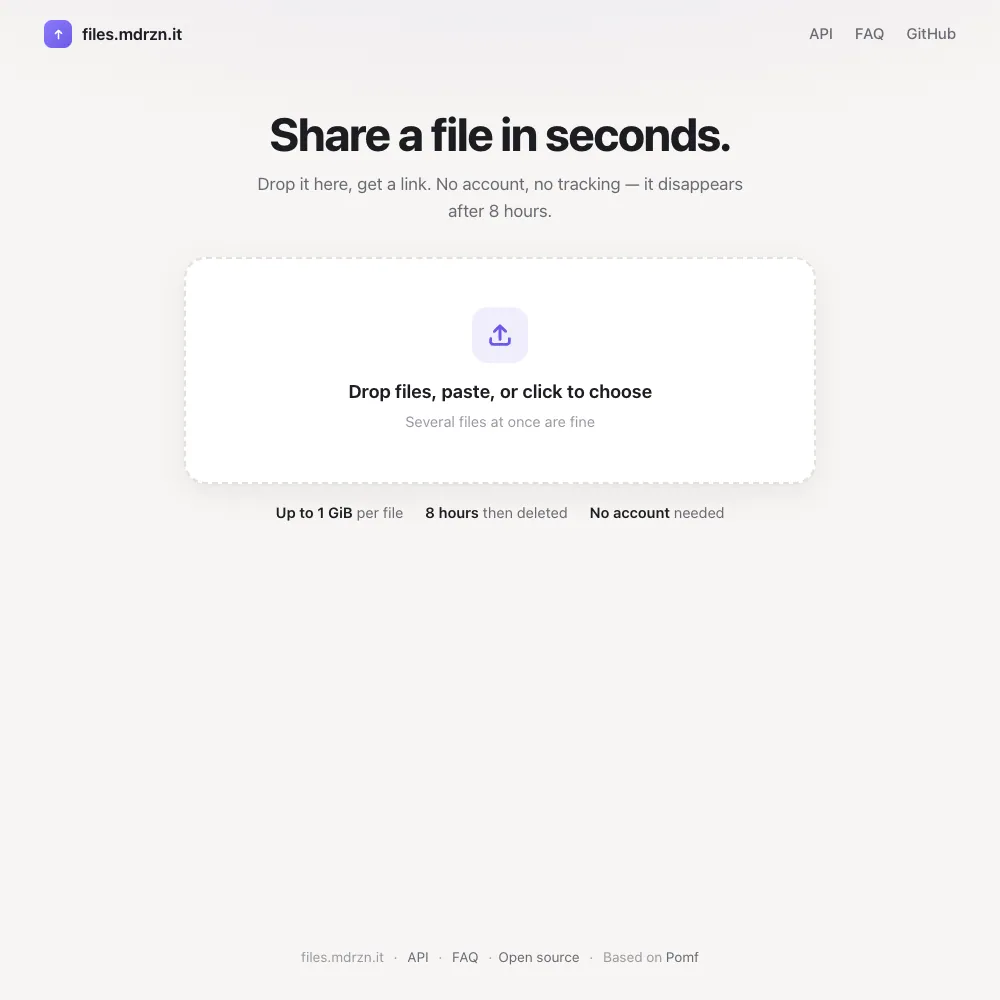
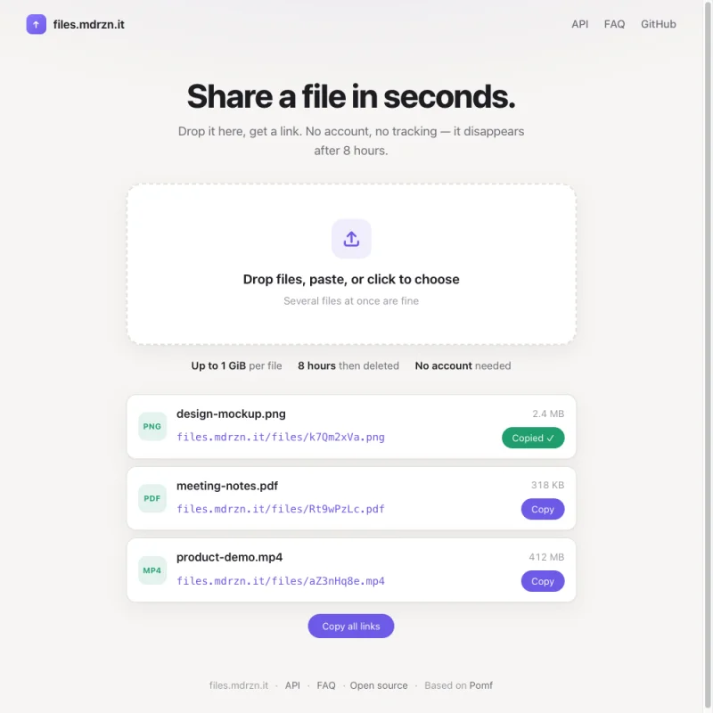
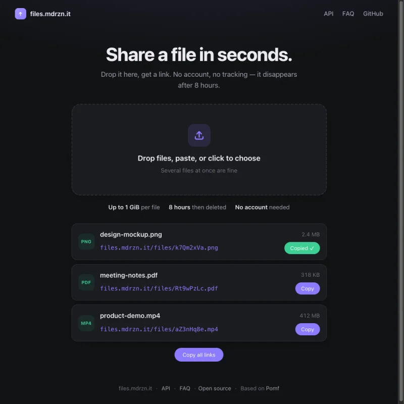

<h1 align="center">File Sharing</h1>

<p align="center">A lightweight, self-hosted temporary file host. Drop a file, get a link — it disappears after a few hours.<br>
Running at <a href="https://files.mdrzn.it"><b>files.mdrzn.it</b></a>.</p>

<p align="center">
<a href="https://files.mdrzn.it"></a>
</p>

[](https://www.gnu.org/licenses/gpl-3.0)


## Features

- **Drop, paste or pick** — drop files anywhere on the page (it lights up while you drag), paste from the clipboard, or click to choose. Several at once.
- **Large files** — up to 1 GiB per file: anything over 8 MiB is sent in 8 MiB chunks, so it gets through Cloudflare's per-request limit.
- **Links you can use right away** — each file becomes a card with its type, size and progress, then the link and a **Copy** button; **Copy all links** for several files.
- **Temporary by design** — files and their records are deleted after the configured time (8 hours on files.mdrzn.it); abandoned chunked uploads are cleaned up after 24 hours.
- **No account** — no sign-up and no analytics scripts.
- **Light and dark** — follows the system appearance; works on phones.
- **API** — `curl -F "files[]=@file.png" https://files.mdrzn.it/upload` returns JSON, text, CSV or HTML; ShareX config on the [API page](https://files.mdrzn.it/api.html).
- **Abuse controls** — extension/MIME filtering, plus optional upload rate limiting and file-hash blacklisting. On files.mdrzn.it, uploads are served from a separate path where scripts never run.

<table>
<tr>
<td></td>
<td></td>
</tr>
</table>

## Self-hosting

**Requirements:** PHP 8.3 with Fileinfo, PDO and APCu; SQLite, MySQL or PostgreSQL; Node.js 20+ (or Bun), `make`, `jq`, `curl` and `pngquant` for the build.

```sh
git clone https://github.com/mdrzn/file-sharing.git && cd file-sharing
# edit src/config.json: domain, limits, expiry, paths, contacts
npm install
make build-prod BUN=node NODE=node NPM=npm
make install BUN=node NODE=node NPM=npm PHP=php8.3
```

Deploy the generated application outside the web root and expose only its `public/` directory. Serve uploaded files from a separate path with scripts disabled (see `src/static/nginxExamples/` for nginx), and run `checkExpire.php` regularly, e.g. every 15 minutes from cron.

### Large uploads

The browser sends files over 8 MiB to `chunk.php` in sequential 8 MiB chunks; smaller files go to `upload.php`. Each chunk request is multipart with `name`, `total` (bytes), `offset` (bytes), `chunk` and `id` (empty for the first request); continue with the returned `id` and next `offset`. The final response has the usual `files` array, and the assembled file passes the same MIME/extension checks before it's published. Temporary chunks live beside `FILES_ROOT` in a private `chunks/` directory.

Origin settings for 1 GiB: PHP `upload_max_filesize=1024M`, `post_max_size=1056M`, `max_input_time=3600`; Apache `LimitRequestBody 1107296256`. Deploy `chunk.php` alongside `upload.php`.

## Support

Open an issue at [github.com/mdrzn/file-sharing/issues](https://github.com/mdrzn/file-sharing/issues) or email files@mdrzn.it.

## Credits

File Sharing is based on [Pomf](http://github.com/pomf/pomf), written by Emma Lejack & Go Johansson (nekunekus / nokonoko) with help from the open source community. Interface and chunked uploads by [mdrzn](https://github.com/mdrzn).

## License

Free software, released under the GPL-3.0 license. See `LICENSE`.
